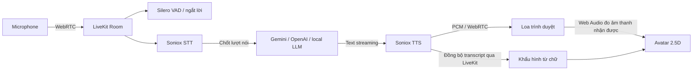

# voice-agent

Trợ lý hội thoại hai chiều bằng **LiveKit Agents + Soniox STT/TTS**, có nhân vật
từ ảnh nhép miệng theo âm thanh, chớp mắt và nghiêng đầu khi nói.

Nhân vật đóng vai trò nhân viên hỗ trợ hành chính công tại kiosk: xưng **em**,
gọi người dùng là **anh/chị**, giao tiếp lịch sự, rõ ràng và tận tình. Vai trò
được cấu hình trong `prompts/system.md`; lời chào đầu phiên đặt bằng `AGENT_GREETING`.

Project độc lập, tích hợp luồng voice từ `kiosk-voice-agent` và bộ vẽ nhân vật
Portrait Motion Studio V13. Chế độ ảnh 2D vẽ avatar trên trình duyệt; chế độ
**FlashHead Lite** dựng video trực tiếp trên server GPU NVIDIA và phát qua LiveKit.
Mẫu thử trên L40S đạt 84–85 FPS dựng ở video 25 FPS, đã được người dùng duyệt.
Xem [báo cáo tích hợp](docs/FLASHHEAD_LIVE_INTEGRATION.md) và
[hướng dẫn deploy GPU](deploy/avatar-flashhead/LIVE.md). Silero VAD là
phần ML chạy trên CPU; STT, LLM và TTS mặc định gọi dịch vụ qua mạng.

## Chạy trên Windows

Đưa cả ứng dụng lên máy GPU đã có FlashHead: xem
[hướng dẫn chạy cùng máy GPU Windows](docs/DEPLOY_GPU_WINDOWS.md).

```powershell
git clone https://github.com/giau1002/voice-agent.git
cd voice-agent
powershell -ExecutionPolicy Bypass -File scripts/setup.ps1
```

Script cài Node.js 24 LTS, uv, Python 3.12 và LiveKit server vào `.tools/` nếu
chưa có; kiểm checksum các binary tải về. Dependency Python và npm được khóa
bằng `uv.lock` / `web/package-lock.json`. Không cần Docker hoặc quyền admin.

Điền `.env` đã được tạo từ `.env.example`:

```dotenv
SONIOX_API_KEY=<khóa Soniox>
LLM_PROVIDER=gemini
GEMINI_API_KEY=<khóa Gemini>
```

Sau đó:

```powershell
powershell -ExecutionPolicy Bypass -File scripts/start.ps1
```

Mở **http://127.0.0.1:8790** → **Bắt đầu trò chuyện** → cho phép micro.
Nút **Ngắt lời** hoặc nói qua micro
để dừng câu trả lời hiện tại. Ctrl+C tại cửa sổ chạy script để dừng các tiến trình.
Log nằm trong `logs/`, không được commit.

Giao diện kiosk giữ nhân vật lớn bên trái, phần hướng dẫn thủ tục bên phải;
không có khung chat hay ô nhập tin nhắn. Bấm **Bắt đầu trò chuyện**, nói tên
thủ tục hoặc chạm một nội dung gợi ý để được hỗ trợ. Khi nói cần đăng ký khai
sinh, trợ lý hỏi có muốn mở tờ khai để điền ngay không; đồng ý thì mở form.

Nói **“Mở biểu mẫu giúp tôi”**, đồng ý lời mời của trợ lý, hoặc bấm **Mở biểu mẫu**.
Công cụ `open_birth_form` mở tờ khai ngay bên cạnh nhân vật; hỏi về một thủ tục
không tự mở form. Nói **“Đóng biểu mẫu”** để trở lại hướng dẫn, giữ bản nháp
trong phiên. Biểu mẫu hiện có là **Tờ khai đăng ký khai sinh**, gồm thông tin
trẻ, cha mẹ và người đi đăng ký; chưa kết nối tiếp nhận hồ sơ thực tế.
Màn hình nhỏ chuyển thành bố cục dọc. Độ há hàm mặc định **150%**, tối đa
**180%**; chỉnh micro, loa và chuyển động tại nút cài đặt.

## OCR và hỏi đáp điền form

Mở biểu mẫu rồi chọn **Tải PDF hoặc hình ảnh**, tải PDF (kể cả bản scan)
hoặc ảnh JPG/PNG/WebP tối đa **8 MB**; ảnh tối đa 20 megapixel. OCR dùng
`GEMINI_API_KEY` trên server và `OCR_MODEL=gemini-2.5-flash`, độc lập với
nhà cung cấp LLM hội thoại. Tệp được gửi dạng inline tới Gemini, không lưu vào
ổ đĩa của ứng dụng. Tệp lỗi, PDF khóa hoặc chữ không đọc được có thông báo để thử lại.

Mẫu **Tờ khai đăng ký khai sinh** trong ứng dụng có 21 ô, chia thành ba nhóm:
thông tin trẻ; thông tin cha mẹ; thông tin người đi đăng ký. Có tám mục chính
để hoàn thành tờ khai: tên trẻ, ngày sinh, giới tính, nơi sinh, tên mẹ, tên
người đăng ký, quan hệ với trẻ và địa chỉ người đăng ký. Các mục như thông tin
cha, ngày sinh cha mẹ, dân tộc, quốc tịch, quê quán, giấy tờ tùy thân, điện thoại
và nơi đăng ký dự kiến là bổ sung. Các mục chính được đánh dấu trên giao diện.

OCR chỉ điền thông tin nhìn thấy và xác định được đúng vai trò, để trống mục chưa rõ;
cụ thể, tên mẹ trên giấy chứng sinh không tự biến thành tên trẻ hoặc tên người đăng ký.
Ngày sinh được kiểm tra lịch và chuẩn hóa; ngày không hợp lệ được để trống kèm cảnh báo.
Có thể mở **Đối chiếu văn bản từ tài liệu** để kiểm tra. Tải thêm tài liệu bổ sung thông tin
OCR và giữ các mục đã sửa bằng tay. Nếu OCR lỗi, bản nháp hiện có vẫn được giữ.

1. Kiểm tra thông tin đã nhận, sửa trực tiếp nếu cần.
2. Trợ lý hỏi từng mục còn thiếu bằng giọng nói và cập nhật phiếu bằng công cụ
   `update_birth_form`. Sau OCR, phiếu tự đồng bộ để tiếp tục hỏi đáp nếu đang kết nối.
3. Có thể nói yêu cầu sửa thông tin. Muốn sửa trực tiếp, chọn **Dừng hỏi đáp để chỉnh sửa**.
   Tải thêm tài liệu sẽ tạm dừng hỏi đáp, đọc thông tin rồi tự tiếp tục.
4. Khi đủ thông tin, kiểm tra rồi xác nhận bằng lời hoặc nút **Xác nhận tờ khai**.

Đây là tờ khai khai sinh, chưa gửi hồ sơ đến cơ quan nào. Trợ lý gọi đúng
tên tờ khai và xác nhận ngắn thông tin đã cập nhật.
Dữ liệu form chỉ nằm trong bộ nhớ tab/phiên LiveKit; tải lại trang sẽ mất bản nháp.
Khi ngắt kết nối, hỏi đáp dừng và bản nháp trên tab vẫn giữ để tiếp tục ở phiên mới.
API `/api/documents/ocr` dùng cùng mã truy cập/kiểm tra origin như API tạo phiên,
giới hạn 6 yêu cầu/phút/IP và tối đa 2 lượt OCR đồng thời mỗi tiến trình.

## Ngày giờ và thông tin thực tế

Mỗi yêu cầu tới LLM (giọng nói, nhập chữ hoặc sau khi gọi công cụ) đều nhận ngày,
thứ, giờ mới từ đồng hồ server theo `AGENT_TIMEZONE=Asia/Ho_Chi_Minh`. Không cố
định ngày vào prompt; qua nửa đêm trợ lý tự nhận ngữ cảnh ngày mới. Máy chủ cần
đồng bộ giờ hệ thống chính xác. Dependency `tzdata` hỗ trợ múi giờ trên Windows.

`WEB_SEARCH_ENABLED=false` tạm tắt tìm kiếm web để ưu tiên hội thoại nhanh.
OCR tài liệu vẫn hoạt động riêng. Muốn bật lại, đặt `WEB_SEARCH_ENABLED=true`
để dùng Gemini + Google Search với `GEMINI_API_KEY` hiện có và
`WEB_SEARCH_MODEL=gemini-3.1-flash-lite`.
Công cụ dùng được cả khi LLM chính là Gemini, OpenAI hoặc local. Tin mới, thời
tiết, giá cả, người đương nhiệm và quy định hiện hành cần tra cứu; hỏi ngày giờ
hoặc trò chuyện thông thường không cần gọi web. Search có thể phát sinh phí theo
tài khoản Gemini và mất thêm thời gian khi truy vấn.

Ưu tiên phản hồi nhanh: nhu cầu khai sinh được hỏi mở tờ khai ngay;
cách dùng kiosk và điền biểu mẫu không gọi web. Khi bật tìm kiếm, câu hỏi tiếp nối dùng lại nguồn
đã xác minh trong hội thoại khi đủ căn cứ. Truy vấn giống nhau được lưu tối đa
90 giây, riêng từng phiên, tối đa 8 kết quả thành công; lỗi không được lưu.
Mỗi lần tra cứu có giới hạn `WEB_SEARCH_TIMEOUT_SECONDS=8`, không tự thử lại;
hết thời gian thì nói
rõ chưa xác minh được, không đoán phí hay quy định hiện hành.

`WEB_SEARCH_FAST_RESPONSES=true` giảm mức suy luận chỉ cho yêu cầu tìm kiếm,
độc lập với LLM hội thoại. Đặt `false` để dùng mặc định của nhà cung cấp cho tìm
kiếm. `Web lookup completed` ghi thời gian tra cứu, không ghi câu truy vấn.
Luồng STT, TTS, micro và avatar dùng cấu hình trước tối ưu tìm kiếm.

Khung chat hiển thị nguồn và gợi ý tìm kiếm do nhà cung cấp trả về. Chỉ kết quả có
grounding metadata và nguồn thực mới được xác nhận; lỗi tra cứu trả trạng thái
không xác minh được, không dùng lại câu trả lời phỏng đoán. Nguồn web không thay
thế việc tích hợp dữ liệu hồ sơ hoặc cơ sở dữ liệu nghiệp vụ. Khi chưa có key hoặc
tắt tìm kiếm, trợ lý nhận đúng trạng thái không có web trong ngữ cảnh.

LiveKit Cloud: đặt `LIVEKIT_URL=wss://...`, `LIVEKIT_API_KEY`,
`LIVEKIT_API_SECRET` theo project của bạn, rồi chạy `scripts/start.ps1 -CloudLiveKit`.
`LIVEKIT_SERVER_URL` chỉ dùng khi worker/API cần địa chỉ nội bộ khác với browser.

## Phát triển thủ công

Yêu cầu Node.js 24 LTS, uv và Python 3.12:

```powershell
uv sync --frozen
uv run -m livekit.agents download-files
Copy-Item .env.example .env  # chỉ khi chưa có .env
cd web
npm ci
npm run dev
```

Ba terminal khác ở thư mục gốc:

```powershell
# LiveKit local; khóa devkey/devsecret chỉ dành cho localhost
.tools/livekit/livekit-server.exe --config deploy/livekit.local.yaml --bind 127.0.0.1

uv run uvicorn voice_agent.api:app --host 127.0.0.1 --port 8790 --reload
uv run python -m voice_agent.worker dev
```

Web dev tại **http://127.0.0.1:5173**, proxy `/api` sang cổng 8790.
`npm run build` trong `web/` tạo bản web do FastAPI phục vụ cùng origin.

## Luồng xử lý



- LiveKit điều phối transport, VAD, turn-taking và interruption; LiveKit không
  phải mô hình LLM. `turn_detection="stt"` dùng endpoint của Soniox để chốt câu.
- Repo mẫu dùng **Soniox**, không phải Cartesia Sonic. TTS mặc định Soniox
  `tts-rt-v1-preview`, voice `Nina`, tiếng Việt. Có thể đổi model/voice bằng `.env`.
- STT mặc định `stt-rt-v4`, chốt lượt 1000 ms; đầu vào micro dùng mặc định SDK
  24 kHz/50 ms như trước. Nếu đã cập nhật bản thử STT v5, chạy
  `.venv/Scripts/python.exe scripts/restore-voice-config.py` rồi khởi động lại
  worker để khôi phục hai giá trị STT trong `.env`, giữ các khóa và cấu hình khác.
- LLM: `gemini`, `openai`, hoặc `local`. Local cần `LLM_BASE_URL` và `LLM_MODEL`.
  `LLM_PROVIDER=local` hỗ trợ endpoint OpenAI-compatible như Ollama/vLLM.
- Prompt nằm ở [`prompts/system.md`](prompts/system.md), được đọc phía worker.
  Có OCR và eForm; chưa kết nối dữ liệu công dân hoặc catalog nghiệp vụ chính thức.
- Token server tạo identity/phòng ngẫu nhiên, chỉ cấp quyền join phòng đó,
  publish microphone/data và subscribe. Named dispatch gọi worker `portrait-voice`.
- API không gửi khóa Soniox, Gemini, OpenAI hoặc LiveKit secret xuống browser.

## Avatar và đồng bộ môi

Giao diện giữ bộ ảnh/khẩu hình V13 đã hiệu chỉnh: 11 mức mở hàm, phối hợp các
dáng A/E/I/O/U/M/B/P/F/V và mỉm cười. Mắt chớp mỗi 2–3 giây, đầu nghiêng nhẹ
khi có lời nói thực tế. Trong Cài đặt có mức cử động đầu, độ há hàm và độ trễ môi.
Độ nhạy khẩu hình được hiệu chỉnh cho tiếng TTS nhỏ: nguyên âm mở rõ hơn, phụ
âm khép môi vẫn khép, khoảng im tiếng có nhịp nhả mềm. Mức há hàm chọn trên các
khẩu hình đã hiệu chỉnh, không kéo giãn cả khuôn mặt; không đổi tốc độ đọc hay
nhịp ước lượng từ chỉ để làm miệng mở lớn.
Độ mở hàm cuối cùng (sau nhấn âm và năng lượng audio) đi qua bộ giảm chấn có
giới hạn vận tốc/gia tốc để môi dưới không bật nhanh. Kênh hàm dùng mục tiêu
khẩu hình gốc, không chồng thêm hai lần làm mượt; độ rộng môi vẫn được làm
mượt riêng. Biên độ mặc định 150% và mức tối đa 180% giữ nguyên.

Web Audio phân tích **remote track của agent**, không phân tích micro người dùng
để nhép miệng avatar. Môi chỉ cử động khi agent đang nói và audio nhận được có
tín hiệu; im tiếng thì khép lại. Transcript `lk.transcription` được LiveKit gửi
đồng bộ với playout, giúp chọn khẩu hình theo nội dung từ. Ngắt lời/xóa track/
ngắt kết nối đều xóa khẩu hình cũ.

**Giới hạn thực tế:** bộ Soniox TTS hiện dùng chưa xuất mốc phoneme/viseme.
Khẩu hình trong từ vẫn ước lượng từ chữ và được điều tiết bởi năng lượng audio,
chưa phải forced alignment. Đây là ảnh 2.5D, không phải đầu 3D hay neural video.
Không phóng to góc đầu vượt giới hạn nhỏ vì nền phía sau là ảnh gốc.

## Thiết bị

Chọn microphone và loa trong **Thiết bị & chuyển động**. Micro bật echo
cancellation, noise suppression và auto gain control. Đổi loa phụ thuộc hỗ trợ
`setSinkId` của trình duyệt. Chrome/Edge desktop thường phù hợp để thử kiosk.
Nếu autoplay bị chặn, bấm **Bật âm thanh trả lời**. Ngoài localhost, microphone
cần HTTPS. Windows native phù hợp phát triển; triển khai server nên dùng Linux.

## Kiểm tra

```powershell
uv run pytest -q
cd web
npm test
npm run build
```

Hoặc `scripts/check.ps1`. Kiểm tra gồm token/auth/CORS/rate-limit/cleanup,
contract các plugin đã cài, vòng đời kết nối/hủy, transcript chia đoạn,
barge-in, audio-gated lip sync và điều khiển giao diện.

Test transport LiveKit thật (không gọi dịch vụ trả phí):

```powershell
$env:VOICE_TEST_LIVEKIT_URL='ws://127.0.0.1:7880'
uv run pytest tests/test_livekit_transport.py -q
```

Test này tạo hai peer WebRTC, truyền text và audio PCM tổng hợp rồi xóa phòng.
Mặc định được skip khi chưa đặt biến trên. Không coi test này là kiểm chứng
giọng Soniox, độ trễ hội thoại thực tế hoặc độ tự nhiên khi phát trong browser.

## Triển khai

Xem [`docs/DEPLOY.md`](docs/DEPLOY.md). Có Dockerfile và Compose cho API/web,
worker và tùy chọn LiveKit local. Worker cần mạng ổn định, không cần GPU cho
avatar hiện tại. Không đưa `.env` hoặc `.tools` lên GitHub.

Chưa có khóa dịch vụ thì trang vẫn hiện nhân vật và thông báo những biến còn
thiếu; nút kết nối bị khóa để tránh giả vờ có phiên AI đang chạy.

## Cấu trúc

```text
voice_agent/       config, token API, provider factories, LiveKit worker
web/src/          React + TypeScript, voice client, audio meter, lip sync
web/public/avatar/  ảnh và bộ vẽ V13 độc lập
prompts/          hướng dẫn hệ thống cho LLM
scripts/          setup/start/check trên Windows
tests/            backend và LiveKit transport smoke
deploy/           Dockerfile, cấu hình LiveKit local
docs/             vận hành, contract, nguồn và giới hạn kiểm chứng
```

Nguồn tích hợp: [`docs/PROVENANCE.md`](docs/PROVENANCE.md).
