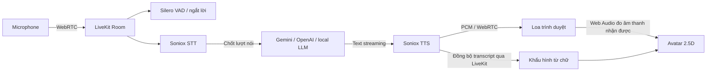

# voice-agent

Trợ lý hội thoại hai chiều bằng **LiveKit Agents + Soniox STT/TTS**, có nhân vật
từ ảnh nhép miệng theo âm thanh, chớp mắt và nghiêng đầu khi nói.

Project độc lập, tích hợp luồng voice từ `kiosk-voice-agent` và bộ vẽ nhân vật
Portrait Motion Studio V13. Không cần backend GPU để vẽ avatar. Silero VAD là
phần ML chạy trên CPU; STT, LLM và TTS mặc định gọi dịch vụ qua mạng.

## Chạy trên Windows

```powershell
git clone https://github.com/giau1002/voice-agent.git
cd voice-agent
powershell -ExecutionPolicy Bypass -File scripts/setup.ps1
```

Script cài Node.js 24 LTS, uv, Python 3.12 và LiveKit server vào `.tools/` nếu
chưa có; kiểm checksum các binary tải về. Dependency Python và npm được khóa
bằng `uv.lock` / `web/package-lock.json`. Không cần Docker hoặc quyền admin.

Điền `.env` đã được tạo từ `.env.example`:

```dotenv
SONIOX_API_KEY=<khóa Soniox>
LLM_PROVIDER=gemini
GEMINI_API_KEY=<khóa Gemini>
```

Sau đó:

```powershell
powershell -ExecutionPolicy Bypass -File scripts/start.ps1
```

Mở **http://127.0.0.1:8790** → **Bắt đầu trò chuyện** → cho phép micro.
Có thể nhập tin nhắn khi không có micro. Nút **Ngắt lời** hoặc nói qua micro
để dừng câu trả lời hiện tại. Ctrl+C tại cửa sổ chạy script để dừng các tiến trình.
Log nằm trong `logs/`, không được commit.

Giao diện kiosk có banner đỏ, nền hoa văn trống đồng và nhân vật trên nền trong
suốt. Các tab **Thủ tục phổ biến**, **Tìm kiếm**, **Mẫu đơn** cho phép chọn chủ đề
để hỏi trợ lý; tìm kiếm hỗ trợ tiếng Việt không dấu và mã thủ tục. Danh mục mẫu
ở `web/src/data/procedures.ts` lấy nhãn từ ảnh tham khảo, chưa kết nối cổng dịch vụ
công hay kho mẫu đơn chính thức. Độ há hàm mặc định **120%**; điều chỉnh micro,
loa và chuyển động tại nút cài đặt.

LiveKit Cloud: đặt `LIVEKIT_URL=wss://...`, `LIVEKIT_API_KEY`,
`LIVEKIT_API_SECRET` theo project của bạn, rồi chạy `scripts/start.ps1 -CloudLiveKit`.
`LIVEKIT_SERVER_URL` chỉ dùng khi worker/API cần địa chỉ nội bộ khác với browser.

## Phát triển thủ công

Yêu cầu Node.js 24 LTS, uv và Python 3.12:

```powershell
uv sync --frozen
uv run -m livekit.agents download-files
Copy-Item .env.example .env  # chỉ khi chưa có .env
cd web
npm ci
npm run dev
```

Ba terminal khác ở thư mục gốc:

```powershell
# LiveKit local; khóa devkey/devsecret chỉ dành cho localhost
.tools/livekit/livekit-server.exe --config deploy/livekit.local.yaml --bind 127.0.0.1

uv run uvicorn voice_agent.api:app --host 127.0.0.1 --port 8790 --reload
uv run python -m voice_agent.worker dev
```

Web dev tại **http://127.0.0.1:5173**, proxy `/api` sang cổng 8790.
`npm run build` trong `web/` tạo bản web do FastAPI phục vụ cùng origin.

## Luồng xử lý



- LiveKit điều phối transport, VAD, turn-taking và interruption; LiveKit không
  phải mô hình LLM. `turn_detection="stt"` dùng endpoint của Soniox để chốt câu.
- Repo mẫu dùng **Soniox**, không phải Cartesia Sonic. TTS mặc định Soniox
  `tts-rt-v1-preview`, voice `Nina`, tiếng Việt. Có thể đổi model/voice bằng `.env`.
- LLM: `gemini`, `openai`, hoặc `local`. Local cần `LLM_BASE_URL` và `LLM_MODEL`.
  `LLM_PROVIDER=local` hỗ trợ endpoint OpenAI-compatible như Ollama/vLLM.
- Prompt nằm ở [`prompts/system.md`](prompts/system.md), được đọc phía worker.
  Chưa mang nghiệp vụ eForm, OCR, dữ liệu công dân hoặc catalog của repo mẫu sang.
- Token server tạo identity/phòng ngẫu nhiên, chỉ cấp quyền join phòng đó,
  publish microphone/data và subscribe. Named dispatch gọi worker `portrait-voice`.
- API không gửi khóa Soniox, Gemini, OpenAI hoặc LiveKit secret xuống browser.

## Avatar và đồng bộ môi

Giao diện giữ bộ ảnh/khẩu hình V13 đã hiệu chỉnh: 11 mức mở hàm, phối hợp các
dáng A/E/I/O/U/M/B/P/F/V và mỉm cười. Mắt chớp mỗi 2–3 giây, đầu nghiêng nhẹ
khi có lời nói thực tế. Trong Cài đặt có mức cử động đầu, độ há hàm và độ trễ môi.

Web Audio phân tích **remote track của agent**, không phân tích micro người dùng
để nhép miệng avatar. Môi chỉ cử động khi agent đang nói và audio nhận được có
tín hiệu; im tiếng thì khép lại. Transcript `lk.transcription` được LiveKit gửi
đồng bộ với playout, giúp chọn khẩu hình theo nội dung từ. Ngắt lời/xóa track/
ngắt kết nối đều xóa khẩu hình cũ.

**Giới hạn thực tế:** bộ Soniox TTS hiện dùng chưa xuất mốc phoneme/viseme.
Khẩu hình trong từ vẫn ước lượng từ chữ và được điều tiết bởi năng lượng audio,
chưa phải forced alignment. Đây là ảnh 2.5D, không phải đầu 3D hay neural video.
Không phóng to góc đầu vượt giới hạn nhỏ vì nền phía sau là ảnh gốc.

## Thiết bị

Chọn microphone và loa trong **Thiết bị & chuyển động**. Micro bật echo
cancellation, noise suppression và auto gain control. Đổi loa phụ thuộc hỗ trợ
`setSinkId` của trình duyệt. Chrome/Edge desktop thường phù hợp để thử kiosk.
Nếu autoplay bị chặn, bấm **Bật âm thanh trả lời**. Ngoài localhost, microphone
cần HTTPS. Windows native phù hợp phát triển; triển khai server nên dùng Linux.

## Kiểm tra

```powershell
uv run pytest -q
cd web
npm test
npm run build
```

Hoặc `scripts/check.ps1`. Kiểm tra gồm token/auth/CORS/rate-limit/cleanup,
contract các plugin đã cài, vòng đời kết nối/hủy, transcript chia đoạn,
barge-in, audio-gated lip sync và điều khiển giao diện.

Test transport LiveKit thật (không gọi dịch vụ trả phí):

```powershell
$env:VOICE_TEST_LIVEKIT_URL='ws://127.0.0.1:7880'
uv run pytest tests/test_livekit_transport.py -q
```

Test này tạo hai peer WebRTC, truyền text và audio PCM tổng hợp rồi xóa phòng.
Mặc định được skip khi chưa đặt biến trên. Không coi test này là kiểm chứng
giọng Soniox, độ trễ hội thoại thực tế hoặc độ tự nhiên khi phát trong browser.

## Triển khai

Xem [`docs/DEPLOY.md`](docs/DEPLOY.md). Có Dockerfile và Compose cho API/web,
worker và tùy chọn LiveKit local. Worker cần mạng ổn định, không cần GPU cho
avatar hiện tại. Không đưa `.env` hoặc `.tools` lên GitHub.

Chưa có khóa dịch vụ thì trang vẫn hiện nhân vật và thông báo những biến còn
thiếu; nút kết nối bị khóa để tránh giả vờ có phiên AI đang chạy.

## Cấu trúc

```text
voice_agent/       config, token API, provider factories, LiveKit worker
web/src/          React + TypeScript, voice client, audio meter, lip sync
web/public/avatar/  ảnh và bộ vẽ V13 độc lập
prompts/          hướng dẫn hệ thống cho LLM
scripts/          setup/start/check trên Windows
tests/            backend và LiveKit transport smoke
deploy/           Dockerfile, cấu hình LiveKit local
docs/             vận hành, contract, nguồn và giới hạn kiểm chứng
```

Nguồn tích hợp: [`docs/PROVENANCE.md`](docs/PROVENANCE.md).
