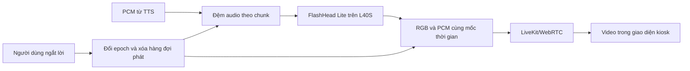

# Nghiên cứu avatar tự chạy cho kiosk — 22/10/2026

## Quyết định thử nghiệm

Chọn **SoulX-FlashHead Lite** làm ứng viên đầu tiên để đo trên NVIDIA L40S. Dùng
mạng tạo chân dung chuyển động từ ảnh và âm thanh; triển khai lớp truyền âm thanh,
đồng bộ và vòng đời phiên của riêng dự án. Không sử dụng Simli, HeyGen, bitHuman
hay API avatar tính phí. Chưa kết luận model đạt chất lượng hoặc tốc độ sản phẩm.

**Cập nhật 22/10/2026:** đã nhận kết quả chạy thật trên L40S. Mẫu đạt 84–85 FPS
dựng, RTF khoảng 0,295; người dùng đã duyệt chất lượng video. Chọn cấu hình này
để chuyển sang giai đoạn tích hợp. Xem [báo cáo L40S](FLASHHEAD_L40S_RESULT_20261022.md).
Chưa đo hội thoại qua LiveKit/trình duyệt.

**Cập nhật tích hợp:** đã code GPU HTTP service, LiveKit audio/video output, idle
và bỏ kết quả cũ khi ngắt lời. Kiểm thử LiveKit thật trên máy phát triển đã qua
với renderer giả lập; chưa deploy GPU thật theo yêu cầu người dùng. Xem
[báo cáo tích hợp](FLASHHEAD_LIVE_INTEGRATION.md).

Không cố tái tạo mô hình nền của nhà cung cấp từ đầu bằng một GPU. Khả thi hơn là
dùng trọng số công khai, tự xây dịch vụ suy luận và phần tích hợp web. Phần huấn
luyện từ đầu sẽ cần dữ liệu khuôn mặt/âm thanh và tài nguyên khác xa server hiện có.

## Chứng cứ từ mã nguồn

Đã clone và đọc trực tiếp:

| Nguồn | Kết quả đánh giá |
|---|---|
| FlashHead Lite, commit `9bc03de06bb0de82cd6bc477804512ae06144bf2` | Có cache chuyển động, xử lý âm thanh thành chunk và trả tensor video. Source mặc định còn import xfuser dù chạy một GPU; có sẵn SDPA fallback. Có thể tách khỏi Gradio/MP4. Chọn làm thử nghiệm. |
| Ditto, commit `c3e47eee2e626500017a0556b470d6d4182f85e8` | Có pipeline online, PyTorch/TensorRT; mẫu phát hành còn dùng InsightFace và landmark203. Chưa chọn làm nền triển khai thương mại với bộ weights hiện tại. |
| LAM + WebRender | Kiến trúc Gaussian 3D/browser hấp dẫn về chi phí, nhưng LICENSE_WEIGHT trong repo gốc ghi CC BY-NC 4.0. Không chọn bộ weights đó cho dự án triển khai sản phẩm. |
| LiveTalking | Có kiến trúc WebRTC và hàng đợi để tham khảo; đổi framework không tự cải thiện chất lượng model MuseTalk/Wav2Lip bên trong. |

Nguồn chính thức: [FlashHead](https://github.com/Soul-AILab/SoulX-FlashHead),
[Ditto](https://github.com/antgroup/ditto-talkinghead),
[giấy phép trọng số LAM](https://github.com/aigc3d/LAM/blob/master/LICENSE_WEIGHT),
[LiveTalking](https://github.com/lipku/LiveTalking).

FlashHead Lite có trọng số transformer Apache-2.0 và VAE_LTX Open-RAIL-M theo
[model card](https://huggingface.co/Soul-AILab/SoulX-FlashHead-1_3B).
Đây là thông tin phân loại tài sản của upstream; không đồng nhất giấy phép mã nguồn
với giấy phép mọi trọng số. Bộ tải lưu model card cùng hash/revision.

## Giải thích tốc độ và đầu ra

Tác giả công bố Lite 96 FPS trên RTX 4090 và Pro 10,8 FPS trên RTX 4090. Chọn Lite
để đánh giá tương tác; không lấy video đẹp của Pro làm bằng chứng chất lượng Lite.
Nguồn: [README](https://github.com/Soul-AILab/SoulX-FlashHead#-highlights).

Từ `infer_params.yaml`, `inference.py`, `generate_video.py` và cấu hình VAE:

- 512×512, 25 FPS; 33 khung trong cửa sổ, 9 khung lịch sử, 24 khung mới = 0,96 s.
- Âm thanh cache 8 giây được đệm im lặng ở đầu, không phải đợi thu đủ 8 giây.
- Gradio gom **3 chunk**, tương ứng 2,88 giây mới, rồi encode từng MP4. Không dùng
  nguyên demo đó làm chatbot trực tiếp.
- Ảnh được mã hóa chuẩn bị trước, model giữ trong VRAM. Mỗi chunk audio vẫn phải
  suy luận mới. Renderer trả RGB + PCM cùng offset thay vì ghi PNG/MP4 trên đường nóng.
- 96 FPS không phải độ trễ tính từ lúc người dùng nói xong. TTS có thể tạo nhanh
  hơn thời gian phát; thời gian chờ chunk phải đo theo luồng PCM thực tế.

Windows L40S đã chạy được FlashHead Lite trong runtime riêng với PyTorch 2.7.1/cu128,
theo report nhận ngày 22/10. Trước đó phép thử PyTorch 2.0.1/cu118 chỉ xác nhận CUDA
cơ bản. Gói thử không đổi chế độ GPU hay dừng llama-server/python đang dùng bộ nhớ.

Đường chạy Windows thử nghiệm dùng SDPA của PyTorch, tắt torch.compile và không
cài NCCL/xfuser/FlashAttention ngoài. Không hứa tốc độ như benchmark Linux. Nếu
chậm, cần xác định phần chiếm thời gian trước khi cân nhắc runtime Linux tối ưu;
không tự thay OS, driver hoặc TCC của server đang vận hành.

## Thiết kế sản phẩm dự kiến

Một model đang nóng; cache âm thanh/chuyển động tách theo phiên. Bước đầu chỉ một
phiên GPU để đo, chưa suy ra khả năng nhiều kiosk từ FPS. Hàng đợi có giới hạn;
nếu GPU không theo kịp thì dừng/rebuffer cả hình và tiếng, không phát giọng chạy
trước hình. Khi ngắt lời phải bỏ kết quả GPU thuộc epoch cũ và chuyển idle mượt.

Idle/đợi trả lời cũng cần chuyển động: có thể chuẩn bị một vòng idle từ chính model
rồi chuyển tiếp theo trạng thái, hoặc suy luận silence khi đủ tài nguyên. Cần thử
để tránh nhảy tư thế. Bản tích hợp đã dùng silence và giữ cache chuyển động;
tính liên tục khi ngắt lời vẫn cần kiểm tra trên đường hội thoại thực.

## Tiêu chí đo đề xuất

Mẫu ngắn đã được duyệt hình ảnh và có RTF dưới 0,8. Các tiêu chí về hội thoại dài,
đồng bộ và độ trễ trên trình duyệt vẫn chưa được đo.

1. Giữ gương mặt, không rung nền, không biến dạng răng/môi thấy rõ ở kích thước kiosk.
2. Warm RTF <= 0,8 với audio liên tục; đo p50/p95 và spike từng chunk. Không chỉ xem
   FPS trung bình của UNet/DiT.
3. Đo thêm độ trễ avatar từ PCM đầu tiên đến cặp hình/tiếng phát đầu tiên; mục tiêu
   thử nghiệm <= 1,5 s. Tách khỏi STT, LLM, TTS và thời gian mở phiên.
4. Đồng bộ âm/hình trong trình duyệt: mục tiêu sai lệch <= 80 ms; ngắt lời <= 250 ms
   tính từ tín hiệu interrupt đã nhận. Đây là chỉ tiêu thiết kế, chưa có kết quả.
5. Lặp hội thoại dài, câu tiếng Việt nhanh/chậm, ngắt câu, số, tên riêng; kiểm tra
   memory không tăng dần và trạng thái của khách trước không lọt sang khách sau.

## Đã làm / còn thiếu

Đã làm: source/model pinning, source compatibility patch, persistent engine adapter,
PCM chunker, kiểm tra offset/epoch, benchmark hai lượt warm, báo cáo timing và bản
ghi để đánh giá chất lượng. Có bài kiểm thử phần không cần GPU và import source.

Đã kiểm tra thực tế trên Windows máy phát triển với PyTorch 2.7.1 CPU: import mã
FlashHead đã vá, so khớp SDPA, chạy forward bộ mã hóa audio với cấu hình nhỏ và trọng
số ngẫu nhiên. Đây là kiểm tra tương thích, không phải chạy mô hình được huấn luyện.
Đã kiểm tra resample WAV stereo 24 kHz về mono 16 kHz và đường H264/AAC, bao gồm
giữ khung cuối khi audio kết thúc giữa hai khung hình. Setup sẽ kiểm tra CUDA/BF16
và VRAM của runtime mới trước khi tải trọng số trên server.

Đã nhận và kiểm tra báo cáo suy luận thật trên L40S cùng video do người dùng duyệt:
`artifacts/20261022-111014-3084a2`. Hai lượt warm trên cùng mẫu 6,495 giây đạt
84,24 / 84,98 FPS, PyTorch reserved tối đa 5,54 GiB.

Chưa làm: đo luồng GPU–LiveKit–browser trên mạng thực, hội thoại dài, dịch vụ
nhiều phiên và duyệt chuyển động idle/interrupt liên tục. Kết quả GPU đến từ
server của người dùng; máy phát triển vẫn dùng AMD.

Phạm vi miễn phí: lớp avatar mới không gọi API trả phí. Lớp STT/TTS/LLM hiện tại
của chatbot là vấn đề độc lập; chưa thay hoặc tuyên bố toàn bộ chatbot miễn phí.

## Gói bàn giao

`artifacts/avatar-flashhead-research.zip`: giải nén ở server, chạy `setup.ps1`.
Chi tiết tại `deploy/avatar-flashhead/README.md`. Bộ thử dùng WAV đã có, không tạo
thêm chi phí TTS. Giữ nguyên giao diện đang hoạt động cho tới khi có kết quả đạt.
